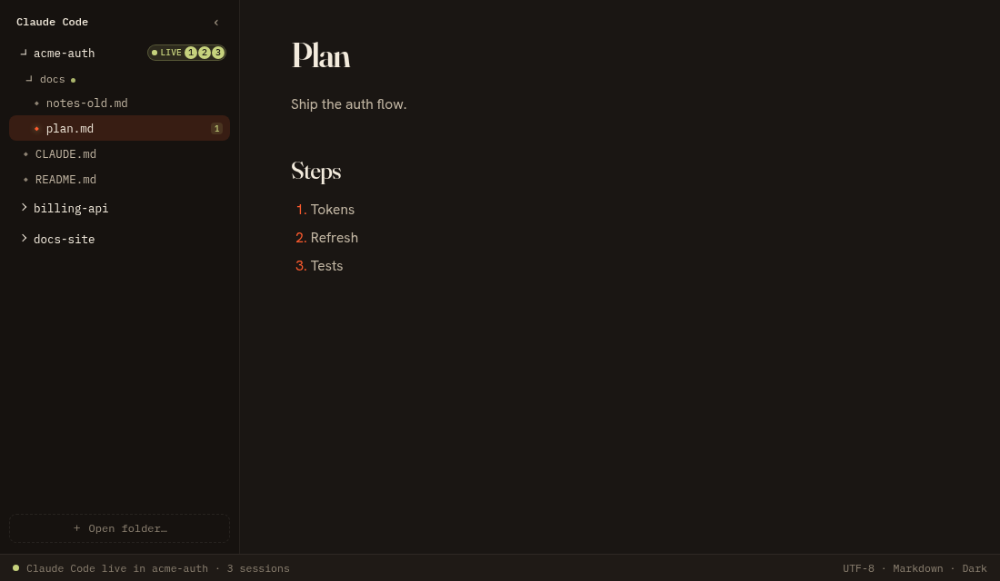
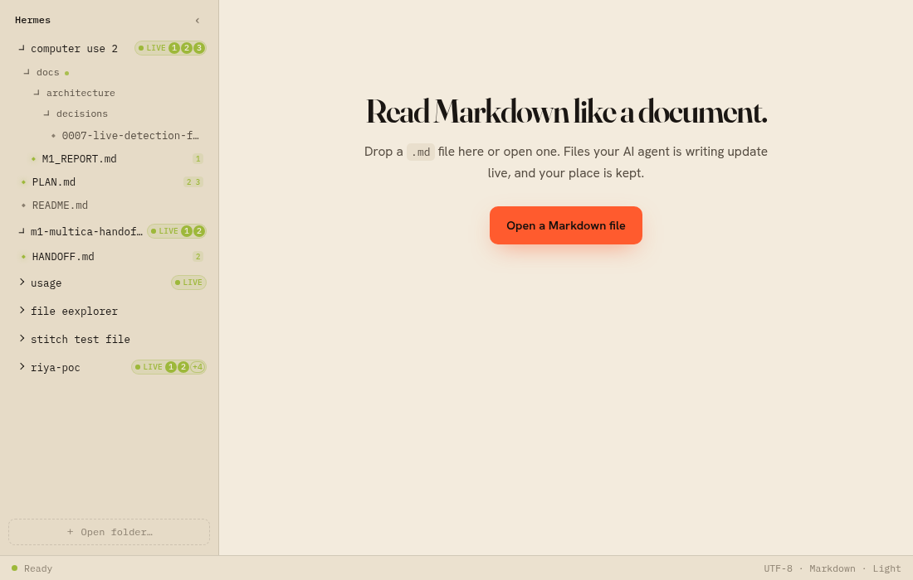
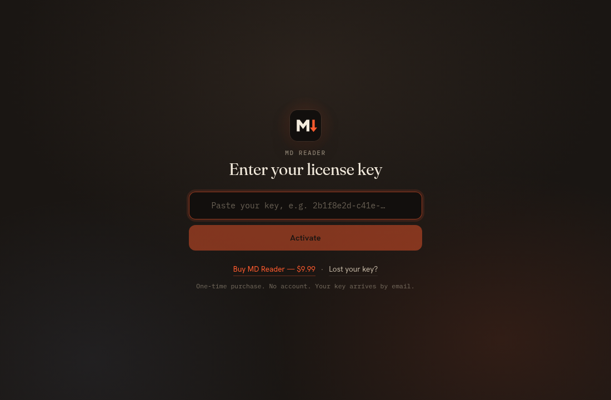

<p align="center">
  
</p>

<h1 align="center">MD Reader for Windows</h1>

<p align="center">
  <strong>See every Markdown file your AI coding agents write, rendered and live.</strong><br>
  Plans, specs, READMEs and handoff notes from Claude Code, Codex, Cursor and more, readable the moment they change.
</p>

<p align="center">
  
  <a href="https://github.com/kunalsahu20/mdreader/releases/latest"></a>
  <a href="https://mdreader.happie.in"></a>
</p>

<p align="center">
  <a href="https://mdreader.happie.in"><strong>Buy MD Reader ($9.99)</strong></a> ·
  <a href="https://github.com/kunalsahu20/mdreader/releases/latest">Download</a> ·
  <a href="https://github.com/kunalsahu20/mdreader/issues/new">Report a bug</a>
</p>

<p align="center">
  
</p>

---

## What it is

AI coding agents write a lot of Markdown: plans, task lists, design notes, reports. Most of it lands in folders you never open, and when you do, you're reading raw `#` and `|` characters in a text editor.

MD Reader is a small, read-only Windows app that finds those files for you and shows them as clean, rendered documents. It notices which agents you have installed, lists the projects they work in, and marks the folder an agent is working in right now. When a file changes on disk, the page updates in place and keeps your scroll position.

It doesn't edit your files, and it doesn't upload them anywhere.

### Works with

MD Reader detects these agents and their projects:

- Claude Code
- OpenAI Codex
- Cursor
- Gemini CLI
- Windsurf
- Kiro
- OpenCode
- GitHub Copilot

You can also open any folder or any `.md` file yourself, so Markdown from other tools works too.

## Features

- **Agent and project detection.** On launch, MD Reader finds the AI agents installed on your PC and the projects they've worked in, and lists them in the sidebar.
- **Live session detection.** A folder an agent is working in right now gets a `● LIVE` badge. When several sessions share a folder you'll see numbered pills (`LIVE 1 2 3`). Click the badge or a number to see what each session is doing and the last Markdown file it touched.
- **Live files.** A `.md` that a session has read or written in the last few minutes is marked in the sidebar: edits glow, reads get a quieter marker. Hover a file to see which session touched it and when.
- **Status bar that tells you what just happened.** For example: which agent is live and in which folder, `plan.md changed on disk, re-rendering…`, then `Updated` with the time. It also reports deleted and newly added files.
- **Live reload, even when minimised.** Pages re-render when the file changes and keep your place. If you were at the bottom, the view follows new content as it's written. Deleted files stay marked until you restart, so you can see what went away.
- **Mermaid diagrams and code highlighting.** Flowcharts, sequence diagrams and other Mermaid blocks render as diagrams. Code blocks get syntax highlighting. Tables, task lists and the rest of GitHub-flavoured Markdown are supported.
- **Dark and light themes.** Switch with `Ctrl+T`. Your choice is remembered, and the window's title bar matches.
- **Opening files your way.** Use `Ctrl+O`, drag a file onto the window, use *Open with* in Explorer, or run `MdReader.exe path\to\file.md`. Relative links to other `.md` files open inside the app, and web links open in your browser.
- **Resizable sidebar.** Drag the divider to resize it, or double-click it to reset. MD Reader remembers the width.

<p align="center">
  
</p>

## System requirements

- Windows 10 or Windows 11, 64-bit (x64)
- Microsoft Edge WebView2 Runtime. It's built into Windows 11 and already on most Windows 10 PCs. If it's missing, MD Reader tells you and links to Microsoft's installer.
- An internet connection when you activate your license key. After that, everyday use works offline.
- No separate .NET install is needed.

## How to buy and activate

MD Reader is a paid app: **$9.99, one time**. There's no subscription and no account, and all updates are included.

Anyone can download the zip from this page, but the app needs a paid license key to run. Without a key, it stops at the activation screen.

1. **Buy** at **[mdreader.happie.in](https://mdreader.happie.in)**. Payment is handled by Dodo Payments.
2. **Get your license key** by email right after you buy.
3. **Download** `MDReader-win-x64.zip` from the [latest release](https://github.com/kunalsahu20/mdreader/releases/latest).
4. **Unzip and run.** Right-click the zip, choose **Extract All**, then open `MdReader.exe` in the extracted folder. Keep the `web` folder next to `MdReader.exe`.
5. **Paste your key** and click **Activate**.

<p align="center">
  
</p>

**One license, one PC.** Each license activates on one PC: the first one you activate it on, and it stays with that PC for good. Reinstalling on the same PC is fine. Buying for another PC needs another license, so activate on the PC you'll actually use MD Reader on. It's fine for personal and commercial use. The full terms are in the [EULA](https://mdreader.happie.in/eula/).

Lost your key email? Write to [kunalsahu1980@gmail.com](mailto:kunalsahu1980@gmail.com) from the address you bought with.

For refunds, see the [refund policy](https://mdreader.happie.in/refund/).

## "Windows protected your PC" (SmartScreen)

MD Reader isn't code-signed yet, so the first time you run it Windows may show a blue **"Windows protected your PC"** box. This is SmartScreen's standard warning for new, unsigned apps. It doesn't mean a virus was found.

To continue, click **More info**, then **Run anyway**. Windows usually asks only once.

Only download MD Reader from this repository's [Releases page](https://github.com/kunalsahu20/mdreader/releases) or from links on [mdreader.happie.in](https://mdreader.happie.in). If a release lists a SHA-256 checksum, you can check your download in PowerShell:

```powershell
Get-FileHash .\MDReader-win-x64.zip -Algorithm SHA256
```

## Privacy

- **No telemetry, no analytics, no account.**
- Your Markdown files stay on your PC. MD Reader reads them locally and never uploads them.
- Agent detection reads local files and window titles, and doesn't change anything.
- The document view is locked down so it can't load anything from the internet. Web links only open in your browser when you click them.
- **The only network traffic is the license check** with Dodo Payments: once when you activate, then a quiet re-check about every two weeks. If you're offline, an activated copy keeps working through a 30-day grace period.

Full details are in the [privacy policy](https://mdreader.happie.in/privacy/).

## Reporting bugs

Please [open an issue](https://github.com/kunalsahu20/mdreader/issues/new). These details help the most:

- Your MD Reader version (from the release you downloaded) and Windows version (`winver`)
- Which agent was running (Claude Code, Codex, Cursor…) and what you expected to see
- A screenshot, if you can share one
- The logs in `%LOCALAPPDATA%\MdReader\`, such as `error.log`. Remove anything private first.

**Please don't post your license key in an issue.** For anything to do with payments or keys, or for a security problem, email [kunalsahu1980@gmail.com](mailto:kunalsahu1980@gmail.com) instead. See [SECURITY.md](SECURITY.md).

## FAQ

**Is this the source code?**
No. MD Reader is closed source. This repository only holds the release downloads, release notes, and the issue tracker.

**Does it edit my files?**
No. It's a reader. It never writes to your Markdown files or to your agents' data.

**Can I use one license on two PCs?**
No. Each license activates on one PC. Reinstalling on the same PC is fine. Buying for another PC needs another license.

**Is it a subscription?**
No. You pay $9.99 once, and all updates are included.

**Can I use it at work?**
Yes. The license covers personal and commercial use.

**Does it need the internet?**
Only to activate your key and for the occasional license re-check. Reading Markdown works offline.

**Mac or Linux?**
Not right now. MD Reader is Windows-only (10 and 11, 64-bit).

**How do I update?**
Download the newest zip from [Releases](https://github.com/kunalsahu20/mdreader/releases/latest) and replace your old folder on the same PC. Your license activation and theme are saved in your Windows user profile, not in the app folder, so they carry over.

## Links

- Website: [mdreader.happie.in](https://mdreader.happie.in)
- Releases: [github.com/kunalsahu20/mdreader/releases](https://github.com/kunalsahu20/mdreader/releases)
- Terms: [mdreader.happie.in/terms/](https://mdreader.happie.in/terms/)
- EULA: [mdreader.happie.in/eula/](https://mdreader.happie.in/eula/)
- Privacy: [mdreader.happie.in/privacy/](https://mdreader.happie.in/privacy/)
- Refund policy: [mdreader.happie.in/refund/](https://mdreader.happie.in/refund/)
- Contact: [kunalsahu1980@gmail.com](mailto:kunalsahu1980@gmail.com) · X [@kunalsahu20_](https://x.com/kunalsahu20_)

## License

MD Reader is proprietary software. The source code is not public. Binaries are licensed under the [MD Reader EULA](https://mdreader.happie.in/eula/). See [LICENSE.md](LICENSE.md).

<sub>© 2026 Kunal Sahu · Made in India</sub>
